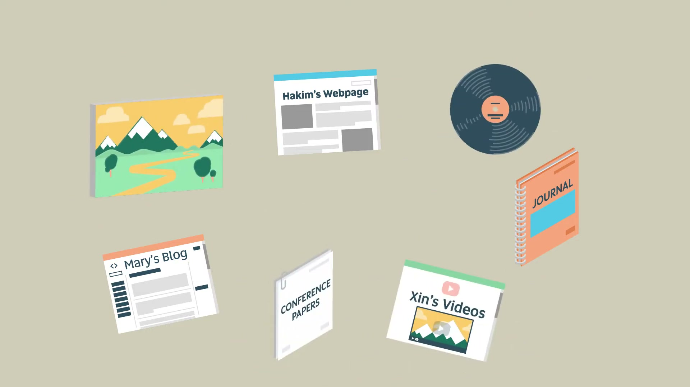
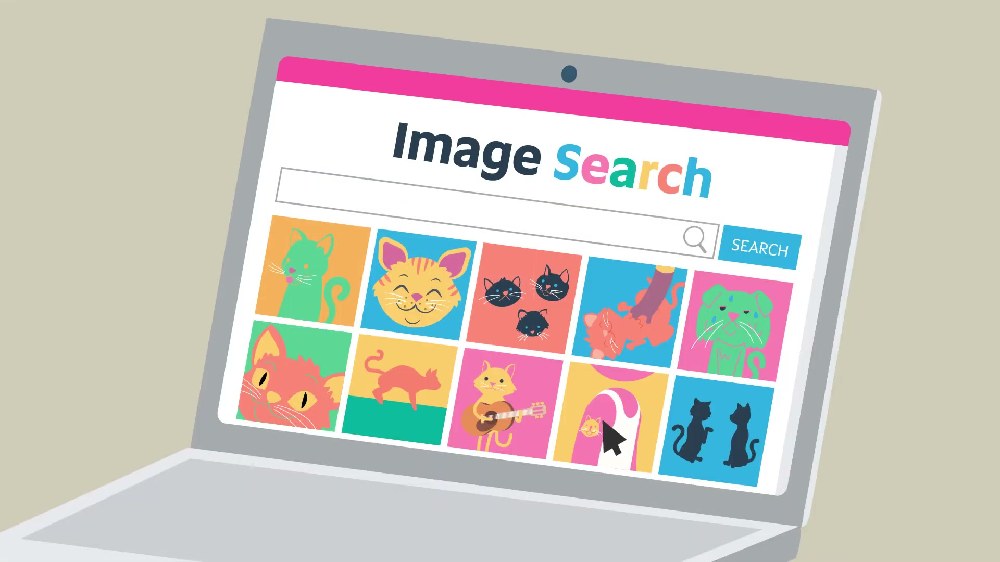
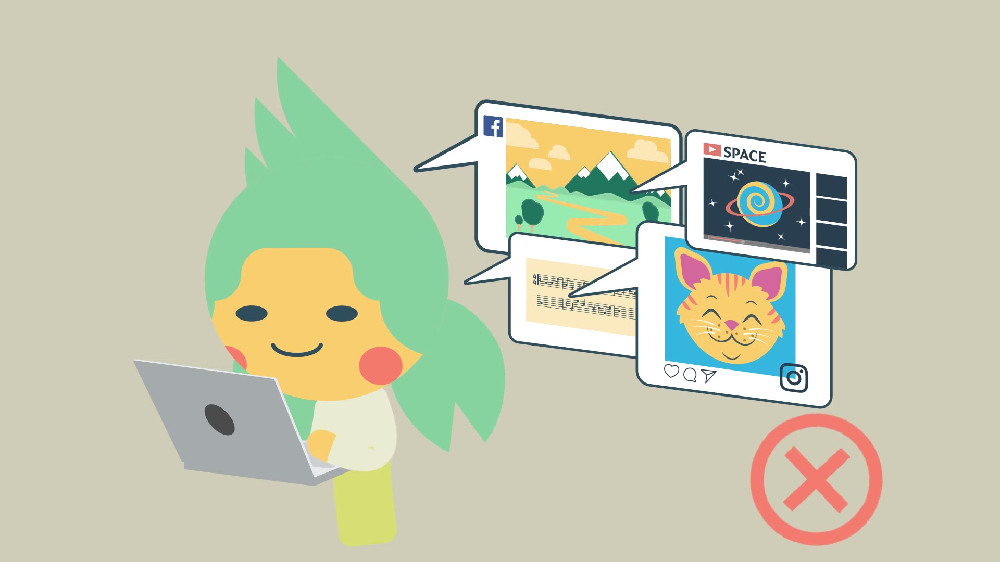
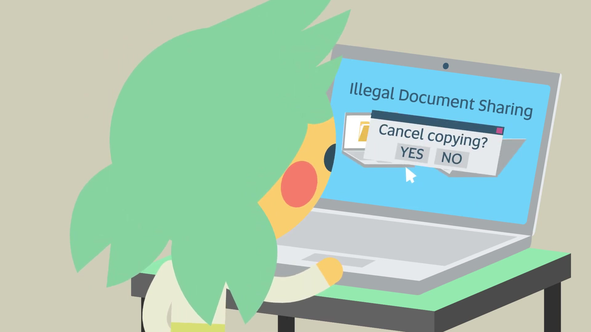

# Study Help: Understanding Copyright

Uploader: University of South Australia  
Video: https://www.youtube.com/watch?v=psUEVRtYzpA

## 00:00 - 02:53 [00:00](https://www.youtube.com/watch?v=psUEVRtYzpA&t=0s)

Summary: Copyright gives owners exclusive rights to reproduce, publish, perform and adapt their work, and moral rights too, so using someone's work without acknowledging it is plagiarism. For research and study, students may copy a reasonable portion - up to 10% of a book, a whole article or an image - as long as they acknowledge the source. Using work without permission outside university study may break the law, and sharing licensed material such as lecture notes, readings or past exam papers on unauthorised sites breaches copyright and the student code of conduct.

_Frame at [00:10](https://www.youtube.com/watch?v=psUEVRtYzpA&t=10s)_

_Frame at [00:56](https://www.youtube.com/watch?v=psUEVRtYzpA&t=56s)_

[00:03](https://www.youtube.com/watch?v=psUEVRtYzpA&t=3s) Copyright protects everyone. Whether you have created a document, an image, a video or sound recording, copyright protects you so that other people can't use your work unfairly. When you want to use other people's work, you must make sure that you use it fairly as well. So what does this mean? Copyright owners have rights. They have a number of exclusive rights to control how their work is used by others. These rights include the right to: reproduce their work in any format, including electronically publish their work, perform or communicate their work; and make adaptations of their work. So you will be infringing copyright if you use someone’s work, or a substantial part of their work, in these ways without their permission.

[00:51](https://www.youtube.com/watch?v=psUEVRtYzpA&t=51s) Copyright owners also have moral rights. This means using other people’s work without acknowledging them in your assignments is plagiarism, even if their work has already been shared online by someone else. At university, one of the ways you acknowledge a person's work is by referencing them in your assignments. As a student at University you are able to copy a reasonable portion of someone else's work as long as it is for your research and study. So what is a reasonable portion? As a general rule you can make a copy of up to 10% of a book even if it is online. You can make a copy of an entire article and you can also make a copy of an image, just make sure you acknowledge your sources. For example, if you find a great image online or want to use some music in your presentation you can do this for your university studies.

_Frame at [01:58](https://www.youtube.com/watch?v=psUEVRtYzpA&t=118s)_

_Frame at [02:23](https://www.youtube.com/watch?v=psUEVRtYzpA&t=143s)_

[01:42](https://www.youtube.com/watch?v=psUEVRtYzpA&t=102s) Copyright will allow this. However, if you want to use someone else's work without their permission, and it is not for your university studies then you may be breaking the law. Using someone else's work without their permission is the same as stealing and it is your responsibility to check any licensing conditions before you go ahead. For example, the University has agreements with publishers which allows students to use content from electronic books and journals for research and study. These agreements do not allow you to share these licensed materials openly outside of the university. Sharing content such as lecture notes, readings, past exam papers and journal articles on unauthorised document sharing sites or without permission is in breach of copyright and against the student code of conduct.

[02:29](https://www.youtube.com/watch?v=psUEVRtYzpA&t=149s) You can be held accountable for this. Copyright protects everyone. It protects others and it also protects you. You don't want someone to steal your hard work and it isn't okay to steal someone else's work. So make sure you comply with copyright. If you need help just ask.
